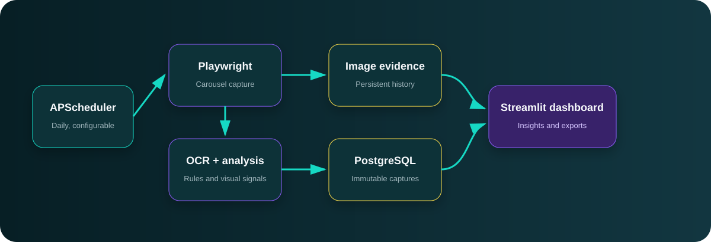

# Banner Analytics

Banner Analytics is a production-oriented promotional intelligence platform for the homepage banner carousels on [LuckyFish](https://www.luckyfish.co.za) and [Hollywoodbets](https://www.hollywoodbets.net). It captures banner evidence daily, extracts content with OCR, classifies campaigns, retains history, compares competitors, and exposes results through an interactive Streamlit dashboard.



## What is included

- Resilient, selector-driven Playwright collection with retries and site-level failure isolation.
- EasyOCR with Tesseract fallback.
- Immutable PostgreSQL capture history, including run status, banner metadata, monetary values, detected dates, and multi-label categories.
- Exact and perceptual image hashes for change detection.
- Rule-based, configurable promotion classification.
- Dominant-colour extraction and visual/content signals.
- A professional Streamlit dashboard with global filters, search, gallery, trends, competitor comparison, operational status, insights, and CSV/Excel exports.
- A separate APScheduler process, avoiding duplicate jobs caused by Streamlit reruns.
- Docker Compose deployment for PostgreSQL, dashboard, and scheduler.
- A demonstration-data fallback, so the dashboard is still reviewable while PostgreSQL is unavailable.

## Quick start with Docker

1. Copy `.env.example` to `.env` and replace the example password values.
2. Start the full stack:

   ```powershell
   docker compose up --build -d
   ```

3. Open `http://localhost:8501`.
4. Run an immediate collection when desired:

   ```powershell
   docker compose run --rm scheduler banner-analytics collect
   ```

The scheduler captures all enabled sites daily at `SCHEDULE_TIME` in `SCHEDULE_TIMEZONE`.

## Local installation

Prerequisites: Python 3.11–3.13, PostgreSQL 15+, Tesseract OCR (optional fallback), and a Chromium-compatible environment.

```powershell
python -m venv .venv
.\.venv\Scripts\Activate.ps1
pip install -r requirements-dev.txt
playwright install chromium
Copy-Item .env.example .env
banner-analytics init-db
streamlit run app.py
```

In another terminal, start the scheduler:

```powershell
.\.venv\Scripts\Activate.ps1
banner-analytics scheduler
```

For UI-only review without PostgreSQL, set `DEMO_MODE=true` in `.env` and run the dashboard. Demo data is clearly labelled and never written to the database.

## Configuration

| File or variable | Purpose |
|---|---|
| `config/sites.yaml` | Site URLs and ordered fallback selectors for carousel, slides, navigation, and overlays |
| `config/categories.yaml` | Extensible categories, keywords, providers, and social platforms |
| `DATABASE_URL` | PostgreSQL SQLAlchemy URL |
| `SCHEDULE_TIME` | Daily run time in `HH:MM` |
| `SCHEDULE_TIMEZONE` | IANA timezone; defaults to `Africa/Johannesburg` |
| `COLLECTOR_TIMEOUT_MS` | Browser action timeout |
| `COLLECTOR_RETRIES` | Retry limit for a site run |
| `OCR_ENGINE` | `easyocr` or `tesseract`; the other engine remains the fallback |
| `BANNER_STORAGE_PATH` | Persistent image storage root |

See [architecture.md](docs/architecture.md), [deployment.md](docs/deployment.md), and [adding-sites.md](docs/adding-sites.md) for the full operating model.

## Operational commands

```powershell
banner-analytics init-db   # create database objects
banner-analytics collect   # collect every enabled site once
banner-analytics scheduler # start the long-running scheduler
pytest                     # run the automated tests
ruff check .               # lint the codebase
```

## Responsible operation

Before enabling production collection, confirm that automated access complies with each website's terms, robots policy, applicable law, and your organization's governance requirements. Keep the default once-daily cadence, identify your traffic where appropriate, and do not attempt to bypass access controls. Site markup can change; failed captures are recorded, visible in Operations, and should be followed by a selector update rather than aggressive retrying.

